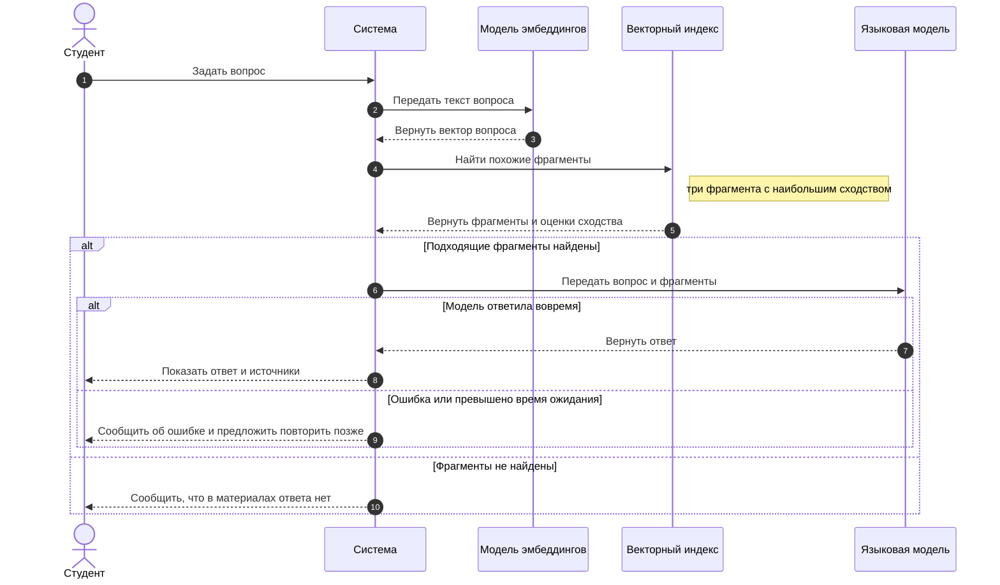
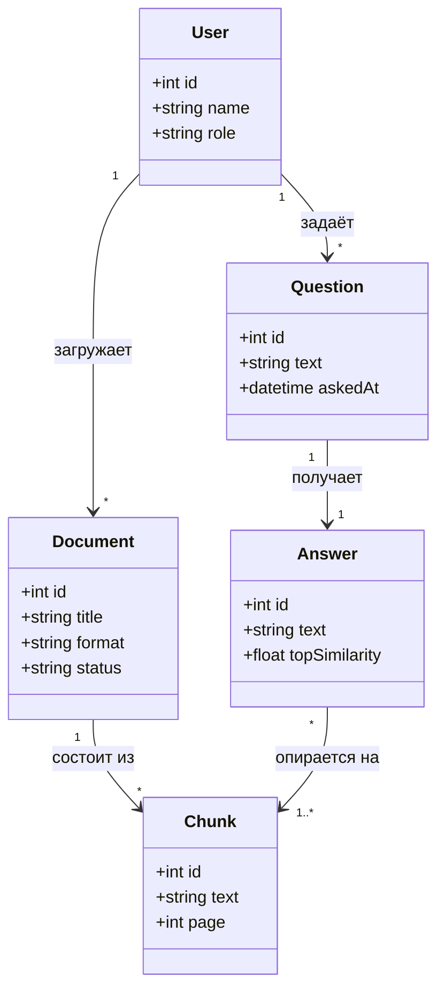

# Диаграммы

## Диаграмма последовательности

Диаграмма показывает выполнение сценария [UC-01. Ответ на вопрос по материалам](requirements.md): от вопроса студента до ответа с источниками, включая оба альтернативных сценария.

Участники диаграммы:

| Участник | Роль |
|---|---|
| Студент | пользователь, задающий вопрос |
| Система | серверная часть: принимает вопрос, координирует работу остальных компонентов |
| Модель эмбеддингов | ML-компонент: превращает текст вопроса в вектор |
| Векторный индекс | хранилище векторов фрагментов материалов, поиск по сходству |
| Языковая модель | ML-компонент: формирует ответ по вопросу и найденным фрагментам |

## Диаграмма классов

Диаграмма описывает основные сущности сервиса и связи между ними.

Сущности:

| Класс | Назначение |
|---|---|
| `User` | пользователь системы; поле `role` принимает значения «студент» или «преподаватель» |
| `Document` | загруженный учебный материал; `status` показывает, проиндексирован ли он |
| `Chunk` | фрагмент материала, по которому ведётся поиск и на который ссылается ответ |
| `Question` | вопрос студента |
| `Answer` | ответ языковой модели; `topSimilarity` — сходство лучшего найденного фрагмента с вопросом |
